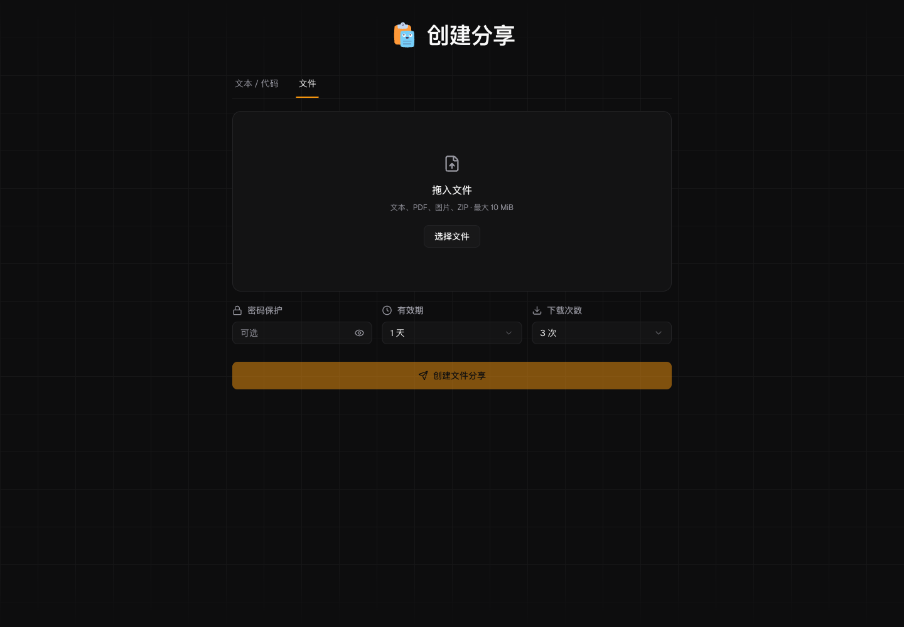

# Paste

自托管的文本、代码和临时文件分享服务。创建链接，设置密码、有效期和访问次数，然后分享。

[在线使用](https://paste.447654.xyz) · [快速开始](#快速开始) · [部署与运维](docs/deployment.md) · [API 文档](docs/api.md) · [反馈问题](https://github.com/dnslin/paste/issues)



## 功能

- **文本与代码**：语法高亮、预览，最多 500,000 个字符。
- **临时文件**：单文件最大 10 MiB，支持 UTF-8 文本、PDF、PNG、JPEG、GIF、WebP 和 ZIP。
- **二维码分享**：文本和文件生成链接后可直接扫码打开；关闭成功弹窗后仍可查看二维码。
- **访问控制**：可选密码、有效期和查看或下载次数限制。
- **加密存储**：文本和文件使用 AES-256-GCM 加密后保存。
- **文件清理**：启动时补跑清理，每五分钟回收失效文件；后台支持手动清理和失败重试。
- **管理后台**：查看统计、管理文本与文件、查看文件占用和删除记录。

| 分享类型 | 有效期 | 次数限制 | 失效后的处理 |
| --- | --- | --- | --- |
| 文本 / 代码 | 5 分钟至 30 天，或永久 | 不限，或 1–10 次 | 停止公开访问，记录保留在后台 |
| 文件 | 5 分钟至 7 天，默认 1 天 | 不限，或 1 / 3 / 5 / 10 次 | 停止访问，随后清理磁盘文件和记录 |

文件界面默认限制为 3 次下载。只有显式领取内容或下载文件才扣次数，打开页面不会扣次数。

## 快速开始

### Docker Compose

需要 Docker Engine 和支持 `docker compose up --wait` 的 Compose 插件。

```bash
git clone https://github.com/dnslin/paste.git
cd paste
cp .env.example .env
```

编辑 `.env`，将 `ADMIN_PASSWORD` 改为自己的管理员密码。密码不能全为空白，最多 72 个 UTF-8 字节。包含 `$`、`#` 等特殊字符时，在 Compose 的 `.env` 中使用单引号包裹整个值。

```bash
docker compose up --detach --build --wait
docker compose ps
```

打开 <http://localhost:3000>。默认配置由 Nginx 提供入口，应用仅在 Compose 网络内开放。首次启动会生成密钥、应用数据库迁移，并把数据保存到 Docker 命名卷。

公网部署及管理后台应使用 HTTPS。mpn-hk 使用宿主机 Caddy 直接代理应用，与仓库默认 Nginx 入口不同。完整配置和操作步骤见[部署与运维](docs/deployment.md)。

### 本地开发

需要 Node.js 24 和 pnpm 11.19.0。本机从源码安装 `better-sqlite3` 时，还需要 Python、make 和 C/C++ 编译工具。

```bash
npm install --global pnpm@11.19.0
git clone https://github.com/dnslin/paste.git
cd paste
pnpm install --frozen-lockfile
cp .env.example .env
```

编辑 `.env`，填写 `ENCRYPTION_KEY`、`SESSION_SECRET` 和 `ADMIN_PASSWORD_HASH`。前两个值可分别生成：

```bash
openssl rand -hex 32
openssl rand -base64 32
```

先在 `.env` 中设置自己的 `ADMIN_PASSWORD`，再生成供 Next.js 环境文件使用的 bcrypt 哈希：

```bash
node --env-file=.env -e 'console.log(require("bcryptjs").hashSync(process.env.ADMIN_PASSWORD, 10).replaceAll("$", "\\$"))'
```

把输出填写到 `ADMIN_PASSWORD_HASH`。输出中的 `\$` 用于避免 [Next.js 环境变量展开](https://nextjs.org/docs/app/guides/environment-variables#referencing-other-variables)。本地直接运行时保留 `TRUST_PROXY=false`。

```bash
pnpm db:migrate
pnpm dev
```

打开 <http://localhost:3000>，管理入口为 `/admin`。

## 配置

| 变量 | Docker | 本地直接运行 |
| --- | --- | --- |
| `ADMIN_PASSWORD` | 管理员密码；启动时生成 bcrypt 哈希 | 仅上面的哈希生成命令使用 |
| `ADMIN_PASSWORD_HASH` | 可选；入口脚本优先使用已提供的哈希 | 必填，bcrypt 哈希 |
| `ENCRYPTION_KEY` | 入口脚本从 `data/.secrets` 加载或首次生成 | 必填，64 位十六进制密钥 |
| `SESSION_SECRET` | 同上 | 填写随机会话签名密钥 |
| `NEXT_PUBLIC_BASE_URL` | 公网部署填写完整来源，如 `https://paste.447654.xyz` | 可选，用于生成分享链接 |
| `TRUST_PROXY` | 仅在可信代理覆盖 `X-Real-IP` 且应用端口私有时启用 | 默认 `false` |
| `FILE_STORAGE_DIR` | 默认 `/app/data/files` | 默认 `data/files` |

仓库默认 Compose 只向容器传入 `ADMIN_PASSWORD`、`TRUST_PROXY` 和 `NEXT_PUBLIC_BASE_URL`。其他 Docker 环境变量需要在 Compose 的 `environment` 中明确配置；仅写入宿主机 `.env` 不会自动传入容器。Docker 入口脚本始终以持久卷中的 `.secrets` 为密钥来源。

## 数据与安全边界

- 服务器持有解密密钥，管理员可查看文本内容。这是服务端加密，不是端到端加密。
- 文件只作为附件下载，不在线预览、执行或解压。类型检查不等于病毒扫描。
- 密码错误、文件缺失和完整性验证失败不会扣次数。服务器批准下载后，网络中断仍可能扣一次；不支持 Range 或断点续传。
- 文件目录上限为 1 GiB；单实例最多同时上传 2 个、下载 4 个。当前部署面向单 Node.js 实例和本地持久化卷。
- 备份必须同时包含 SQLite 数据库、文件目录和密钥。删除线上文件不会移除历史备份中的副本。

更多访问规则见 [API 文档](docs/api.md)，清理与数据恢复见[部署与运维](docs/deployment.md)。

## 开发

基于 Next.js 16 App Router、React 19、TypeScript、SQLite / Drizzle ORM、Tailwind CSS 4、shadcn/ui 和 Shiki。

| 命令 | 用途 |
| --- | --- |
| `pnpm dev` | 启动开发服务器 |
| `pnpm db:migrate` | 应用数据库迁移，可重复执行 |
| `pnpm test` | 运行 Vitest 测试 |
| `pnpm test:watch` | 监听测试 |
| `pnpm test:docker <镜像>` | 用独立空卷验证 Docker 初始化、实际读写及重启，结束后清理测试资源 |
| `pnpm lint` | ESLint 检查 |
| `pnpm exec tsc --noEmit` | TypeScript 类型检查 |
| `pnpm build` | 生成 standalone 生产构建 |
| `pnpm start` | 通过 Next.js 启动生产构建 |

```text
app/                       页面与 API 路由
src/components/paste/      文本分享界面
src/components/file-share/ 文件分享界面
src/components/admin/      管理后台
src/lib/                   加密、访问控制、文件存储与清理
drizzle/                   数据库迁移
data/                      私有运行数据，不提交到 Git
docs/                      运维、接口、设计与验证记录
```

## 文档与贡献

- [部署与运维](docs/deployment.md)：mpn-hk、Docker Compose、Caddy、更新、备份与回滚。
- [API 文档](docs/api.md)：文本与文件接口、参数、错误响应和限额。
- [开发规范](docs/development-guidelines.md) · [UI 设计规范](docs/ui-design-system.md)。

欢迎通过 [Issues](https://github.com/dnslin/paste/issues) 反馈问题，通过 [Pull Requests](https://github.com/dnslin/paste/pulls) 提交改进。修改行为时补充相应测试，并运行测试、类型检查、lint 和构建。不要提交 `.env`、`data/` 或备份文件。

## 许可证

MIT
